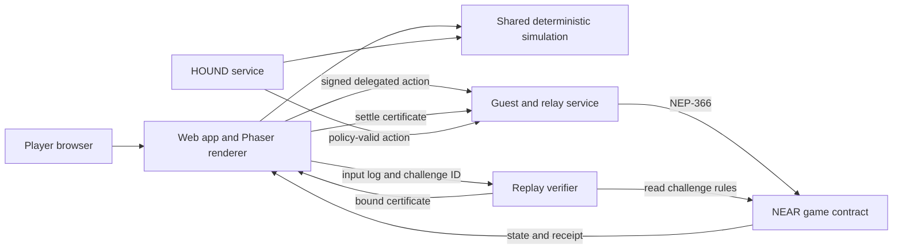

# RivalGhost Implementation Plan

## Current checkpoint — November 12, 2026

The playable local alpha now includes ten Ghost Signal chapters, three rigs, thirty medals, personal best ghosts and a daily challenge. The frontend uses React and Canvas with the approved illustrated arcade style; earlier Phaser/pixel-art items below are historical planning choices, not the current implementation.

Phase 0 and the deterministic simulation foundation are implemented. Game-client work is substantially playable locally. Crown v1 / expedition v2 mission binding, finalized RPC reads, an internal authenticated HTTP verifier, replay storage and wallet transport now exist. Local guest authentication, the verifier gateway and an opt-in testnet provisioning adapter are implemented. Real provisioning validation, the sponsored relay, browser competitive flow, autonomous HOUND and deployed end-to-end integration remain unfinished. This is **not yet a testnet release candidate**.

The local campaign now uses versioned v3 chapter twists and a full-window responsive flight camera; v2 competitive behavior and original ghosts remain separate. See [the immersive update](docs/immersive-flight.md).

Pilot identities, free avatar customization, replay-checked shared boards, rival lists and ghost challenges are now implemented off-chain. Public social use still needs hosting and multi-device validation. See [social play](docs/social-play.md).

See [the development checkpoint](docs/development-status.md) for evidence and the ordered next milestones. The ten-chapter expansion preserves the first three v2 encounters and existing local saves. Story progression adds no contract writes. Current checks: 67 TypeScript tests plus production build/type checking, and ten Rust contract tests pass. The optimized 171,283-byte Wasm artifact fails the unchanged 100,000-byte ceiling. Live storage/gas measurements and physical-device playtests remain outstanding.

## Overview

RivalGhost is a 60-second arcade shooter in which players race a rival’s recorded Ghost, take its Crown and Bounty on NEAR testnet, then defend it while HOUND decides whether a rematch is worth paying for. This plan starts from an empty repository and ships one complete, reproducible vertical slice before expanding screens, rivals, or economy features.

The first release is explicitly a testnet prototype. CR is an internal game-credit ledger held by the NEAR game contract, has no cash value, and is not a transferable token.

## Goals

- Make the game fun before explaining its on-chain systems: move, dodge, shoot automatically, graze danger, trigger Surge, beat a Ghost.
- Deliver the complete funded loop: guest onboarding, 10 CR entry, replay verification, settlement, Crown transfer, explicit 20 CR defense, and HOUND’s real decision.
- Support the same deterministic simulation and competitive rules on desktop and portrait phone layouts.
- Keep every competitive payout auditable through contract state and transaction receipts.
- Keep deployment, storage, and sponsored-transaction costs bounded and measurable.
- Create a small, reviewable commit after every completed task or cohesive vertical slice.

## Non-Goals

- Mainnet deployment, real-money rewards, cash-out, or transferable tokens.
- An on-chain game simulation, on-chain replay inputs, or a full indexer.
- Paid combat advantages, an Armory, a wealth leaderboard, automatic refills, or daily streak systems.
- More than one fully working AI rival before HOUND is reliable.
- A large mobile-native app; the supported target is a browser game with portrait phone play and desktop play.
- Claiming the verifier, guest accounts, or AI rivals are trustless.

## Assumptions and Constraints

- The repository begins empty; this plan creates a pnpm TypeScript monorepo and a Rust NEAR contract.
- The public demo must be ready before the NEAR hackathon deadline on November 14, 2026 at 23:59 UTC.
- HOUND, the Sentinel, and all enemy art are original.
- Gameplay is a 60-second deterministic arena run with automatic fire and directional movement.
- The single competitive loadout is identical for players and HOUND.
- Guest access is disposable in the hackathon build: clearing browser storage loses access unless a recovery flow is later designed and implemented.
- Every commit uses the local Git identity `Thekal33d <jimohkhalid16@gmail.com>`. The repository currently has no Git remote, so commits remain local until a remote URL is supplied.

## Requirements

### Functional

- A player can enter as a guest, receive 100 test CR once, and reach a playable practice or funded challenge within 20 seconds on the target connection.
- The game supports mouse, keyboard, and phone drag input as equivalent capped movement directions per fixed simulation tick.
- The simulation supports seeded enemy waves, input recording, Ghost playback, health, scoring, Graze charge, and a three-second Surge with double eligible kill score.
- The board presents HOUND’s three fixed rungs: Pup, Hound, and Alpha, with honest fixed difficulty descriptions.
- A funded challenge atomically debits 10 CR and locks one Crown. The run cannot settle twice.
- A deterministic verifier accepts only a replay that matches contract-held challenge rules and returns a bound certificate.
- A valid loss or tie applies the 8 CR / 2 CR split; a valid win returns the entry, pays the entire pre-entry Bounty, transfers the Crown and Ghost, and closes that funded contest.
- A winner can explicitly defend for 20 CR while the original 30-minute seed round remains open.
- HOUND holds a separate contract account balance, executes only policy-valid actions, and visibly attacks, targets another Crown, or passes.
- The result flow distinguishes `Replay checked` from `Settled on NEAR`.
- The proof drawer can link the current settlement transaction and show the relevant contract state without exposing wallet or hash terminology in normal game flow.

### Non-Functional

- Use fixed simulation ticks and integer state for cross-device replay equality.
- Target 60 fps on a declared laptop and one mid-range Android phone; rendering may fall to 30 fps without changing game state or results.
- No text below 14 px on supported phone layouts; primary touch controls are at least 48 px high.
- A funded run must not begin until the entry lock is confirmed. Preload the arena and assets while the player reads the preview so confirmation does not feel like a blank wait.
- Game input, animations, and asset loading must remain client-side; the contract stores only minimal settlement state.
- All secrets live in environment variables and are excluded from Git.

## Cost Guardrails

### Deployment and storage

NEAR charges storage collateral separately from gas. Current official documentation says contract storage costs approximately 1 NEAR per 100 KB, and deployment gas scales with contract bytecode size. The target is a release Wasm below 100 KB and a pre-funded contract account with a 2 NEAR testnet/mainnet-equivalent storage-and-deploy buffer until a measured estimate replaces it. [NEAR storage](https://docs.near.org/smart-contracts/anatomy/storage) · [NEAR gas](https://docs.near.org/protocol/transactions/gas)

- Deploy to testnet only for the hackathon. Do not deploy mainnet code or spend mainnet funds without explicit approval.
- Compile a release Wasm in Phase 1 and record its size before any deployment decision.
- Store only balances, active Crowns, active challenges, expiry timestamps, simulation version, replay hash, verifier-key version, and a bounded recent-activity list.
- Store replay files, pixel art, audio, full run telemetry, historical charts, and verbose AI explanations off-chain. The contract stores their content hash only when integrity matters.
- Use compact Borsh structures, short IDs or hashes, bounded collections, and cleanup methods for expired challenges. Add a storage-growth test before public testnet use.

### Sponsored transaction budget

NEP-366 lets a relayer pay gas, but each guest must already be initialized and each delegated action has one receiver. The game contract therefore owns the core state and exposes zero-deposit methods. The relayer identifies the user using `predecessor_account_id`, not `signer_account_id`. [NEAR meta-transactions](https://docs.near.org/protocol/transactions/meta-tx)

- Budget only two player-sponsored competitive writes: `start_challenge` and `settle_challenge`. `defend_crown` is a third write only when the player chooses it.
- Practice runs, board refreshes, Ghost playback, HOUND explanations, and result charts require no transaction.
- Rate-limit guest-account creation and relay submissions by account, session, and IP. Cap one unresolved challenge per account and reject oversized or expired delegated actions before paying gas.
- Keep contract calls single-receiver and zero-deposit. Do not use NEP-141 or NEP-245 transfers for the guest MVP because their 1 yoctoNEAR attachment conflicts with function-call-key constraints.
- Instrument actual gas burnt per method on testnet. Set a per-day sponsor ceiling and an emergency pause for guest creation and relay submission. Never expose the relayer private key to the browser.
- Keep HOUND's own action budget separate from the relayer budget. HOUND's CR choices must not mint credits or silently top up its account.

### UX cost decisions

- Do not make the player wait for a chain read during combat. Fetch challenge state and Ghost data before the run; only the 10 CR entry lock and final payout need chain confirmation.
- Show a crisp pending state after a run: local score → replay checking → settling. Never animate a CR payout before final settlement.
- If the verifier service fails before a final outcome, pause new starts and send the affected challenge through the documented cancellation/refund flow; never label an outage as a normal loss.
- Use finality for money-changing UI and optimistic animation only for reversible presentation.

## Technical Design

### Repository layout

```
rivalghost/
├── apps/
│   ├── web/                 # React, Phaser, responsive menu and game shell
│   ├── verifier/            # deterministic replay verification API
│   └── relayer/             # guest bootstrap and NEP-366 relay API
├── packages/
│   ├── sim/                 # pure deterministic game simulation, shared by web and verifier
│   ├── game-data/           # versioned waves, enemy stats, scoring, content schemas
│   ├── ui/                  # design tokens and reusable menu components
│   └── contracts-client/    # typed NEAR RPC and contract client
├── contracts/
│   └── rivalghost/          # Rust near-sdk contract
├── docs/
│   ├── architecture.md
│   ├── economy.md
│   ├── trust-model.md
│   ├── runbook.md
│   └── cost-model.md
├── scripts/
│   ├── check-costs.mjs
│   └── seed-testnet.mjs
├── PLAN.md
└── README.md
```

### Architecture



### On-chain data model

| Entity | Essential on-chain fields | Deliberately off-chain |
| --- | --- | --- |
| Player | CR balance, first-grant flag, active challenge ID | callsign, device class, personal practice Ghosts |
| Crown round | ID, seed, holder, holder score, Ghost hash, Bounty, entry amount, opened/expires timestamps, state | thumbnail, replay bytes, marketing copy |
| Challenge | ID, Crown ID, challenger, entry, start/expiry, rules version, fixed loadout hash, status | raw input stream, visual split data |
| Certificate | challenge ID, player, score, replay hash, rules version, expiry, verifier key version | verifier trace and diagnostics |
| HOUND | CR balance, active challenge ID, last action time | narrative memory and generated line |
| Activity | last five settled events per round, compact values only | full event feed and analytics |

### Contract interface

| Method | Caller | Behavior |
| --- | --- | --- |
| `init` | deployer, once | sets operator, verifier public key, game rules version, and sponsor policy |
| `create_guest` | authorized bootstrap path | initializes internal CR balance once after account setup |
| `start_practice` | player | issues a seed and rules version; no CR movement |
| `raise_crown` | player or HOUND | consumes an accepted opening certificate, locks a 20+ CR Bounty, creates a round |
| `start_challenge` | player or HOUND | verifies open state, debits 10 CR, creates the 120-second lock |
| `settle_challenge` | player, through relayer | validates and consumes verifier certificate; applies exactly one valid payout |
| `defend_crown` | current holder | locks 20 CR and reopens only within original round expiry |
| `expire_challenge` | anyone or operator worker | applies documented timeout rules |
| `close_round` | anyone | returns remaining Bounty after expiry and archives compact state |
| `cancel_for_service_failure` | narrowly authorized operator | refunds only a documented unresolved outage case |
| views | anyone | board, Crown, challenge, balance, HOUND status, recent activity |

The contract does not accept client-provided seed, score, loadout, or replay hash as authoritative in settlement. It compares every certificate with the stored challenge and rejects reused, expired, mismatched, or already-settled certificates.

### Verifier and replay format

- `packages/sim` has no rendering or network dependencies. It accepts `seed + rulesVersion + loadout + movement-per-tick` and outputs a canonical final state and score.
- The browser encodes directions using a compact fixed-tick representation, hashes the bytes, and uploads the bytes to replay storage.
- The verifier reads authoritative challenge data from the contract, validates size/tick count/monotonic input bounds, runs the shared simulation, writes the replay under its content hash, and signs the bound certificate.
- The contract stores only the replay hash. The UI can show replay availability separately from settlement.
- Unit fixtures run in browser-compatible Node and verifier environments with identical expected score, health, event sequence, and hash.

### HOUND policy

HOUND has a separate game account and follows deterministic hard limits before a model may choose narration or a legal action:

- Keep a 20 CR liquid reserve.
- Risk at most 20 CR to open/defend a Crown.
- Create at most 30 CR of new commitments per round.
- Never challenge its own Crown, create more than one unresolved attempt, mint CR, or bypass the regular verifier and settlement path.
- Choose between revenge, another eligible Crown, funding its own Crown, and pass using contract state.
- The model receives only allowed options and factual inputs. It may explain a selected option in 120 characters, but code validates every number and falls back to a template if validation fails.

### UX flow

1. **Live title:** a safe running scene immediately reacts to drag or mouse movement; `Play 60 seconds` leads into onboarding.
2. **Guest bootstrap:** select an optional generated callsign while account setup runs; no wallet terminology in the normal flow.
3. **Preview:** display HOUND rung, score to beat, current Bounty, `Enter · 10 CR`, exact fixed loadout, and the background/focus-loss rule.
4. **Run:** a 60-second shared arena. Automatic fire; movement, routing, Graze, Surge, health, score and Ghost gap are readable.
5. **Result:** show local score immediately, then replay check, then final settlement. Loss offers `Again · 10 CR` and free practice. Win offers `Defend · 20 CR` and next rung only if valid.
6. **Hold:** show countdown, Bounty, factual HOUND decision, and a replayable attack after settlement.
7. **Proof drawer:** optional transaction and rules evidence for judges and advanced users.

## Implementation Plan

### Serial Dependencies Must Complete First

#### Phase 0: Repository and product contracts
**Prerequisite for:** all implementation

| Task | Description | Output | Commit |
| --- | --- | --- | --- |
| 0.1 | Create the pnpm workspace, Rust contract workspace, editor settings, environment examples, license, and baseline README | reproducible empty project | `chore: bootstrap rivalghost workspace` |
| 0.2 | Convert the product brief into versioned game rules: vocabulary, scoring, Graze/Surge, 60-second wave schedule, input protocol, economy constants, and failure states | `docs/game-rules.md` and JSON schemas | `docs: define RivalGhost game rules` |
| 0.3 | Write cost model and trust model with current testnet assumptions, contract size ceiling, storage budget, sponsor ceilings, and deploy checklist | `docs/cost-model.md`, `docs/trust-model.md` | `docs: define protocol cost and trust model` |
| 0.4 | Choose and record fixed simulation tick rate, portrait playfield dimensions, asset pipeline, and browser support matrix | architecture decision records | `docs: lock simulation and platform decisions` |

#### Phase 1: Deterministic game foundation
**Prerequisite for:** contract certificate verification, Ghosts, and HOUND pilot

| Task | Description | Output | Commit |
| --- | --- | --- | --- |
| 1.1 | Build the pure simulation shell with fixed ticks, movement cap, seeded random number generator, player health, automatic fire, scoring and replayable event log | `packages/sim` with unit tests | `feat(sim): add deterministic arena core` |
| 1.2 | Implement the four 15-second sectors and HOUND-compatible enemy waves; add original enemy IDs, attack tells and deterministic spawn ordering | versioned wave data and fixtures | `feat(sim): add versioned sector waves` |
| 1.3 | Implement Graze → Surge only after a feel prototype; make it integer, deterministic and replay-tested | scoring extension or documented removal | `feat(sim): add graze surge scoring` |
| 1.4 | Define compact input encoding, content hashing, canonical state hash, and cross-runtime fixture tests | replay contract | `test(sim): verify replay parity` |

### Parallel Workstreams

#### Workstream A: Game client and visual prototype
**Dependencies:** Phase 1.1  
**Can parallelize with:** Workstreams B and C

| Task | Description | Output | Commit |
| --- | --- | --- | --- |
| A.1 | Create React shell, Phaser scene, portrait phone layout, desktop framing, drag/mouse/keyboard movement, and auto-fire | playable unranked arena | `feat(web): add responsive arena prototype` |
| A.2 | Add the Sentinel, HOUND Ghost, original enemy placeholder sprites, hit feedback, readable HUD, sectors, and accessibility controls | readable complete run | `feat(web): add RivalGhost combat presentation` |
| A.3 | Build live title, preview, board, result, Hold, and proof-drawer states against local fixtures | complete local UI flow | `feat(web): add crown challenge flow` |
| A.4 | Add result split strip, personal practice Ghost, medals, fast retry and focus-loss behavior | replay-friendly practice flow | `feat(web): add replay and retry feedback` |
| A.5 | Profile and test declared desktop and phone targets; add reduced-motion and lower-effects mode | performance report | `perf(web): optimize target device gameplay` |

#### Workstream B: NEAR contract and cost harness
**Dependencies:** Phase 0.2 and Phase 1.4  
**Can parallelize with:** Workstreams A and C

| Task | Description | Output | Commit |
| --- | --- | --- | --- |
| B.1 | Scaffold Rust near-sdk contract, state structures, initialization, views, compact event format and ownership checks | contract skeleton and tests | `feat(contract): add RivalGhost state model` |
| B.2 | Implement CR ledger, one-time grant, raise Crown, challenge lock, explicit defend and round expiry | economy lifecycle tests | `feat(contract): implement crown economy` |
| B.3 | Implement bound certificate verification, one-time settlement, valid win/loss/tie splits, and controlled cancellation | settlement security tests | `feat(contract): verify and settle replays` |
| B.4 | Add storage-growth, Wasm-size, and per-method gas measurement scripts; impose size/budget failure gates in CI | cost report | `test(contract): enforce storage and gas budgets` |
| B.5 | Deploy a testnet contract only after B1-B4 pass; record address, Wasm hash, actual storage deposit and method gas observations | versioned testnet deployment record | `deploy(testnet): publish game contract` |

#### Workstream C: Guest, relay, verifier, and HOUND services
**Dependencies:** Phase 0.3 and Phase 1.4  
**Can parallelize with:** Workstreams A and B

| Task | Description | Output | Commit |
| --- | --- | --- | --- |
| C.1 | Implement guest account bootstrap with browser-held restricted key, disposable-account disclosure, rate limits and idempotent request handling | bootstrap service | `feat(relayer): create guarded guest onboarding` |
| C.2 | Implement constrained NEP-366 relay endpoint with receiver/method allowlist, nonce/expiry validation, rate limits, receipt polling, gas telemetry and pause switch | relay service | `feat(relayer): sponsor game actions safely` |
| C.3 | Implement replay storage and verifier that reads contract challenge state, checks replay, signs bound certificate and exposes status | verifier API and fixture suite | `feat(verifier): validate deterministic replays` |
| C.4 | Implement HOUND policy worker, test pilot, factual copy validator, decision audit log and a judge-triggered next-decision control | real rival loop | `feat(hound): add policy-bound rival decisions` |
| C.5 | Add structured logs, health checks, metrics for sponsor spend/replay latency/errors, and a local compose development path | operational baseline | `chore(services): add diagnostics and local runtime` |

### Merge Phase

#### Phase 2: End-to-end vertical slice
**Dependencies:** Workstreams A, B, and C

| Task | Description | Output | Commit |
| --- | --- | --- | --- |
| 2.1 | Connect web flow to testnet contract, guest service, relay, verifier and HOUND using the real interfaces | guest-to-settlement path | `feat(app): connect testnet challenge loop` |
| 2.2 | Seed three fixed HOUND rungs from verified runs and record their actual balance, Crown state and replay hashes | reproducible demo fixture | `seed(testnet): initialize HOUND ladder` |
| 2.3 | Exercise win, loss, tie, replay mismatch, duplicate settle, expired lock, verifier outage, round expiry and HOUND pass/attack flows | end-to-end test evidence | `test(e2e): cover funded rivalry lifecycle` |
| 2.4 | Run five unfamiliar-player sessions, including at least two phones and one X in-app-browser arrival; prioritize fixes to control clarity and replay motivation | playtest findings and fixes | `test(playtest): validate first-session loop` |

#### Phase 3: Release quality and submission
**Dependencies:** Phase 2

| Task | Description | Output | Commit |
| --- | --- | --- | --- |
| 3.1 | Replace placeholders with approved original pixel art and sound; complete phone/desktop responsive visual pass | final visual build | `feat(art): complete RivalGhost presentation` |
| 3.2 | Write README, setup instructions, testnet address, trust model, cost report, deployment scripts, demo path and baseline disclosure | judge-readable repository | `docs: prepare hackathon submission` |
| 3.3 | Produce real phone and desktop capture, 15-second ad clip, 75-second demo and screenshots; label edited time or replay acceleration | public media assets | `docs: add demo media and walkthrough` |
| 3.4 | Fresh-clone test, environment validation, public deployment smoke test, error-path rehearsal and pre-submission checklist | release candidate | `chore: validate hackathon release candidate` |

## Commit Protocol

- Create one commit only when the described task is complete, tested and coherent. Do not make empty checkpoint commits.
- Use conventional, imperative messages exactly as proposed unless the work changes materially.
- Inspect `git status` before every commit and stage only files produced by that task.
- Run the narrowest relevant tests before committing; record skipped tests in the commit body or task notes.
- Do not commit `.env`, testnet keys, replay data containing secrets, or service credentials.
- Tag the event baseline before custom work begins and tag the final submission revision as `hackathon-submission`.
- Keep a `docs/CHANGELOG.md` line for every user-visible behavior change.

## Testing and Validation

- Unit test deterministic movement, collisions, health, enemy waves, scoring, Graze/Surge and input decoding.
- Test browser and verifier simulation fixtures for identical final state, score and hash.
- Contract test conservation, first grant once, 8/2 loss split, win payout/entry return, defend, expiry, duplicate settlement rejection, signature mismatch, certificate expiry and storage cleanup.
- Relay test expiry, nonce, method allowlist, account/IP caps, malformed payloads, sponsor ceiling and circuit breaker.
- Verifier test wrong seed, altered inputs, truncated replay, impossible tick count and replay-storage mismatch.
- End-to-end test a fresh browser guest, Pup loss, Pup win, defense, HOUND pass, HOUND attack, HOUND loss, and HOUND win.
- Test portrait phone layout, desktop layout, keyboard-only navigation, reduced motion, screen-reader labels for controls, focus loss, reload recovery and in-app-browser storage loss messaging.
- Record Wasm size, contract state byte growth per player/Crown/challenge, method gas used, account-bootstrap cost and average sponsored cost for each testnet release candidate.

## Rollout and Migration

- Local simulator and mock-contract mode first.
- Private testnet contract and service environment second.
- Limited public testnet with daily guest/relay budget, dashboard and manual pause switches third.
- Public hackathon demo only after a fresh browser completes the entire loop.
- No mainnet rollout is included. A future mainnet decision requires an updated cost model, independent review, explicit user approval and a new deployment plan.
- Roll back the web client by serving the previous immutable deployment. Pause the relay and new guest creation independently. Never mutate a settled Crown to repair a UI bug; ship a corrective client/contract migration with explicit state compatibility.

## Verification Checklist

- [ ] `pnpm install --frozen-lockfile` succeeds from a fresh clone.
- [ ] `pnpm test` runs deterministic simulation, service and UI tests.
- [ ] `cargo test --manifest-path contracts/rivalghost/Cargo.toml` passes.
- [ ] A release Wasm size report is below the approved ceiling and documented.
- [ ] Storage growth and sponsored gas reports remain below their testnet budget ceilings.
- [ ] A fresh guest reaches practice without a wallet prompt.
- [ ] A funded run cannot start without a confirmed lock.
- [ ] An altered replay cannot produce a certificate or payout.
- [ ] A certificate cannot settle twice.
- [ ] A final payout is visible in contract state and receipt before the client says `Settled on NEAR`.
- [ ] HOUND can only execute policy-allowed actions with its own CR.
- [ ] The same Crown can be challenged from desktop and portrait phone under the same rules.
- [ ] The repository has a public README, testnet contract address, demo instructions, trust disclosure and no committed secrets.

## Risk Assessment

| Risk | Likelihood | Impact | Mitigation |
| --- | --- | --- | --- |
| Deterministic replay differs across browser and server | Medium | High | isolate pure simulation package, integer math, fixed-tick fixtures and cross-runtime tests before contract work |
| Contract storage grows with replay/history data | Medium | High | store hashes and bounded activity only; enforce size/growth reports |
| Relay budget is abused by guest creation or invalid requests | Medium | High | rate limits, preflight validation, sponsor ceiling, pause switch and no arbitrary contract methods |
| Phone drag control feels worse than desktop | Medium | High | prototype in Phase 1, test real phones by Phase 2, prioritize controls over cosmetic scope |
| HOUND feels scripted rather than consequential | Medium | Medium | hard budget policy, real separate balance, actual pass and attack evidence, factual copy validation |
| On-chain confirmation makes retries feel slow | Medium | Medium | preload assets, concise pending states, stable recovery and practice while a Crown is locked |
| Art production delays core loop | High | Medium | original placeholder sprites first; replace only after end-to-end path works |
| Testnet RPC or verifier outage disrupts demo | Medium | High | service health checks, status UI, retry-safe IDs, cancellation path and recorded fallback demo labeled honestly |
| Empty repository lacks remote/publishing path | High | Medium | create local commits now; add an authenticated GitHub remote only after its URL and access are confirmed |

## Open Questions

- [ ] Which exact current NEAR testnet account will own the contract and fund the relayer? Do not create or fund one automatically.
- [ ] What GitHub repository URL should receive the local commits?
- [ ] Does the existing game prototype exist in another repository or is this a full greenfield build?
- [ ] Which playfield direction best matches the existing combat: square arena or 9:16 vertical field?
- [ ] Is automatic fire compatible with the existing combat mechanics, or does firing currently have heat/ammo?
- [ ] Which Android and iPhone devices are available for the performance gate?
- [ ] Should skill grants ship after the core, or should players who exhaust 100 CR use practice only?
- [ ] Which service/runtime will host the web app, verifier and relayer during the demo?

## Decision Log

| Decision | Rationale | Alternatives considered |
| --- | --- | --- |
| Use RivalGhost as product name | It communicates the core race against an opponent’s recorded run | Neon Sentinel, Crown Circuit |
| Build one HOUND vertical slice first | One real rival loop is more convincing than three shallow personalities | ship HOUND, VANTA and RUPTURE together |
| Use CR internal ledger in one contract | Enables zero-deposit gameplay calls and limits cross-contract complexity | NEP-141 or NEP-245 token system |
| Testnet only | The hackathon allows it and it removes real-money deployment risk | mainnet integration |
| Keep raw replay data off-chain | Protects storage budget and contract responsiveness | store replay inputs on contract |
| Use a two-step final result | Prevents the UI from presenting a verified local score as a settled payout | single ambiguous verification state |
| Require explicit defense stake | Makes the risk legible and avoids silently withholding a winner’s credits | automatically roll Bounty into next defense |
| Use portrait phone and desktop support | v3 requires equivalent gameplay on both; the logical playfield stays identical | landscape-only mobile or desktop-only game |
