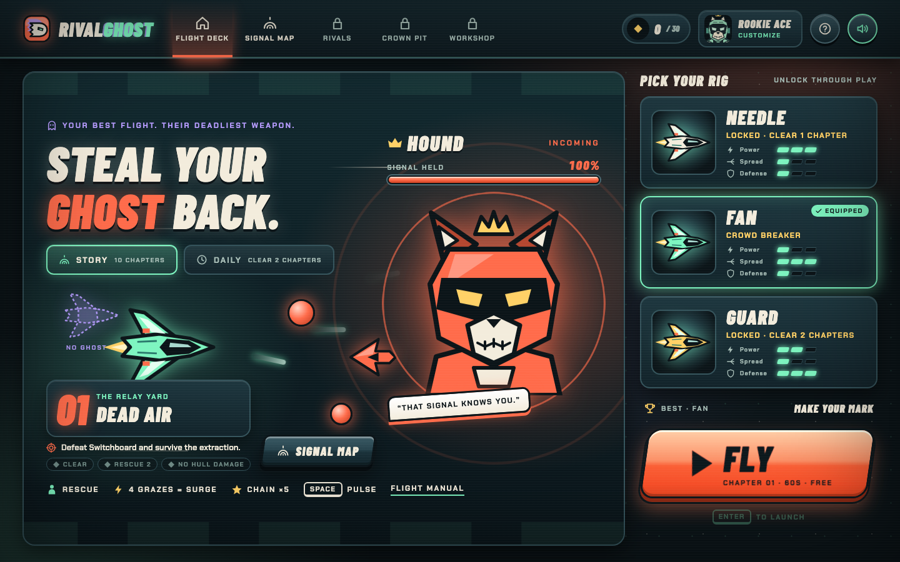
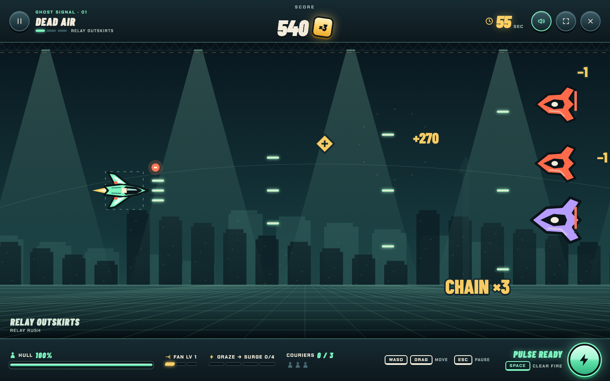
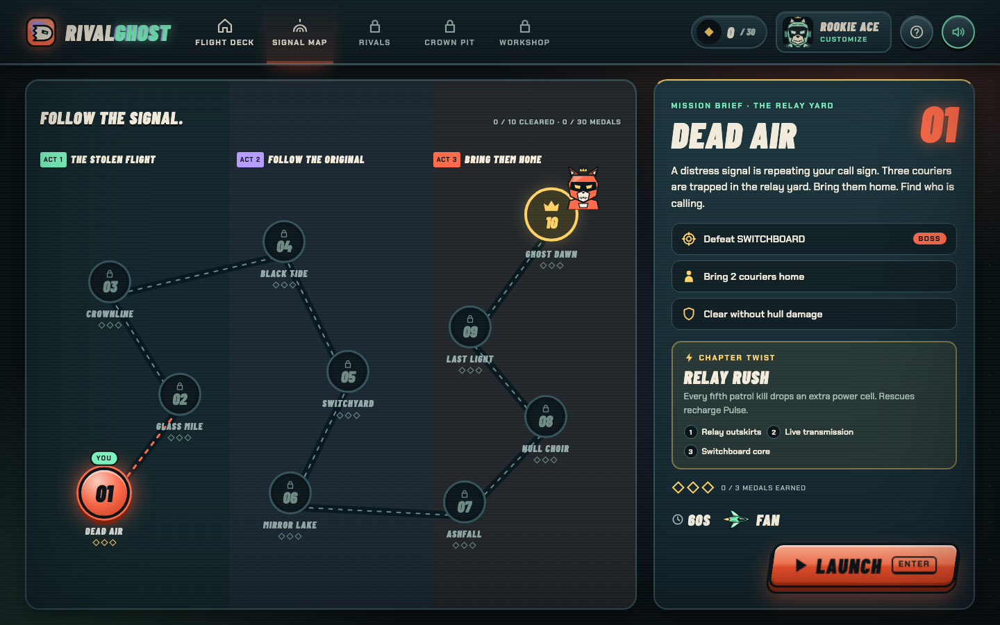
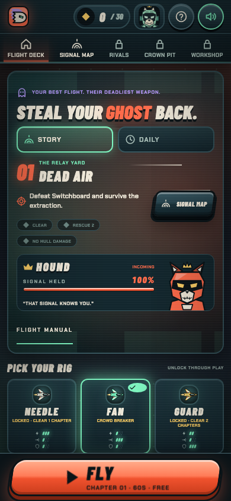
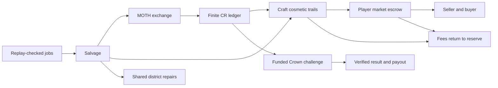
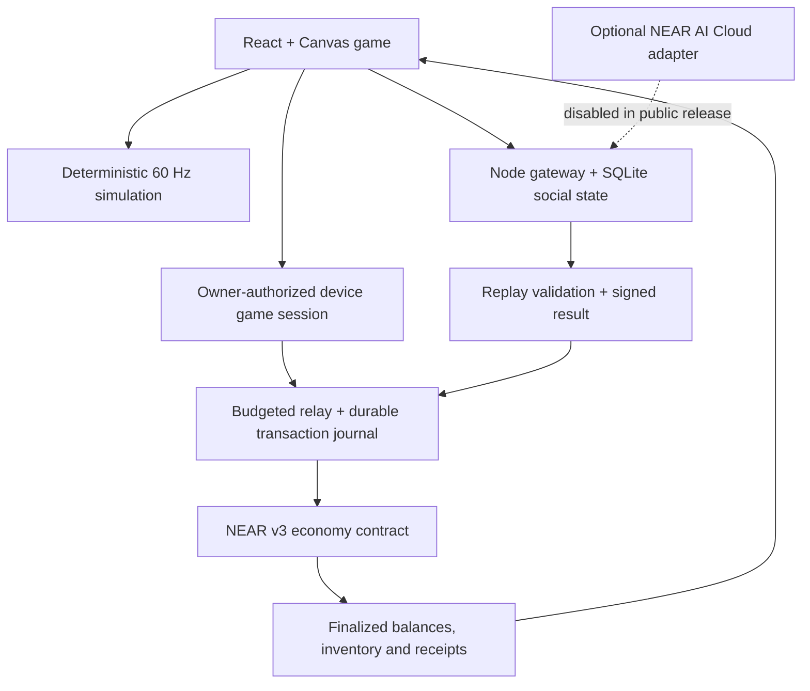

# RivalGhost

**Steal your ghost back.** A browser arcade shooter where a one-minute flight becomes a rival’s next challenge—and the salvage, cosmetics and Crown purses live in a finite NEAR testnet economy.

[**Play RivalGhost**](https://rivalghost.xyz/) · [Review the evidence](docs/evidence/README.md) · [Run locally](#run-locally) · [Contract source](contracts/economy/src/lib.rs)



Actual public build, captured November 14, 2026. No generated mockups or fabricated player activity. [Screenshot provenance](docs/images/README.md).

## The game in one minute

Fly into a district held by HOUND. Graze bullets to trigger a surge, chain kills, rescue couriers, use Pulse to clear danger, and break the boss before extraction. Your best flight becomes a ghost you—or another pilot—can race.

Across ten chapters, the scenery, hazards, bosses and mission twists change. Three free rigs offer different play styles. Thirty medals, a shared daily seed, rival links and progressive unlocks give players a reason to return. Purchases change appearance, never combat strength.



The longer loop is **fly → recover salvage → trade with MOTH → craft or sell cosmetics → rebuild districts → challenge a funded Crown**. The economy changes what players collect, trade and restore; it does not interrupt shooting with transaction prompts.

## Try it in five minutes

1. Open [rivalghost.xyz](https://rivalghost.xyz/) and choose **Play first**. No account, token purchase or browser extension is needed for free flights.
2. Take the flight-school walkthrough, or skip it. Launch Chapter 01 with **Fan**. Move with WASD/arrows or drag; firing is automatic. Space activates Pulse. On mobile, drag to move and tap Pulse. Sound starts after interaction and has a mute control.
3. Finish one story flight—even an unsuccessful attempt—to unlock **Rivals** and **Workshop**. Inspect the result, replay and next unlock. Clearing Chapter 01 also unlocks Needle.
4. Open **Customize** to choose a username/avatar. Eligible completed flights auto-post once a social profile is available (the setting can be turned off in Customize); the server recalculates scores from the replay. Use **Rivals** to chase a recorded flight, not a live multiplayer opponent.
5. For testnet purchases, choose **Sign in → Create account**, save the encrypted recovery file and password, then explicitly **Enable game purchases**. This grants a 12-hour game session. The public release uses a device wallet through `near-api-js`; it does not depend on the blocked hosted NEAR Auth callback.

**Public pilot limits:** account sponsorship is capped at four new accounts per UTC day and the relay has a daily request budget. If exhausted, free play still works. Do not use valuable funds: CR and items are testnet game assets with no cash value. Local setup below uses demo balances, not the public ledger.

### Features open as you play

| Milestone | Opens |
| --- | --- |
| First completed story flight | Workshop and rival ghosts |
| 1 chapter cleared | Needle rig |
| 2 chapters cleared | Guard rig, daily signal, crafting/equipment |
| 3 chapters cleared | Pilot market |
| 4 chapters cleared | Crown Pit |
| 5 chapters cleared | City restoration |
| 6 chapters cleared | HOUND commissions |
| 7 chapters cleared | NPC reactor information; this does **not** activate paid AI or staking |

These are browser-local progression gates, not contract security controls. Returning saves may already have access. Reviewers need not clear seven chapters to verify the implementation: the source, automated checks and real receipts below expose each system directly. [Unlock rules](apps/web/src/player-journey.ts).

<details>
<summary>See the campaign map and mobile Flight Deck</summary>





</details>

## What is implemented—and what is live

| System | Current status | Inspect it |
| --- | --- | --- |
| Arcade campaign | Live: 10 chapters, 3 free rigs, 30 medals, replay ghosts, music/SFX, desktop/mobile layouts | [Simulation](packages/sim/src), [chapter definitions](packages/game-data/src/expedition.ts) |
| Social play | Live server profiles, avatars, replay-checked leaderboards, rival lists and challenge links | [Social behavior and limits](docs/social-play.md) |
| Economic ownership | Live on NEAR testnet: CR, salvage, cosmetics, equipped items, listings, restoration, job/Crown settlement | [Contract](contracts/economy/src/lib.rs), [real transaction evidence](docs/evidence/economy-v3-testnet.json) |
| Recoverable sign-in | Live device account, encrypted backup, sponsored authorization and signed game actions | [Recovery test + receipts](docs/device-wallet.md) |
| MOTH | Contract-enforced stock-sensitive exchange, finite funds, reserve and daily budget | [Economy rules](docs/economy.md) |
| HOUND | Live bounded testnet worker: verified ghosts, separate account, 16 signed actions/day and a 0.48 test-NEAR gas reserve cap. Daily limits can pause round availability | [Activation receipts](docs/evidence/hound-activation-2026-11-14.json), [worker and limits](docs/mobile-and-hound-release.md) |
| NEAR AI Cloud | One successful live inference test; recurring inference **disabled**. No live Cloud-to-contract focus automation | [Usage and latency evidence](docs/evidence/near-ai-first-decision.json) |
| Stake-to-compute / external item standards | Not active. No staking, NEP-245, NEAR Intents or external NFT marketplace integration | [Current limitations](#trust-and-current-limitations) |

This is built for [Games With Real Economies](https://github.com/nearai/near-hackathon-prompt-examples/blob/main/tracks/09-games.md): an arcade loop connected to NPC budgets, player trading and shared restoration. The table above distinguishes that implementation from optional/example integrations in the track prompt.

## A finite economy, with receipts

The deployed contract is **`game.rivalghost-ops-thekal33d.testnet`**. Genesis contains exactly **100,100 CR**: 99,400 in reserve, 100 for HOUND and 600 for MOTH. New-player grants transfer from reserve; there is no mint method in the deployed implementation.



- **Jobs:** replay-derived objectives award salvage; a reserved HOUND commission can pay 8 CR from HOUND’s funds.
- **MOTH:** stock changes quotes. MOTH buys only within its cash, reserve, inventory and daily budget limits.
- **Crafting/market:** materials are consumed; crafting and market fees return CR to reserve. Listed items enter escrow and purchases transfer ownership atomically.
- **Restoration:** donated salvage changes district stages at 10, 30 and 60 contributions. A run freezes its starting stage so later repairs cannot change its replay.
- **Crowns:** 10 CR entry. A verified win returns the entry and awards the existing bounty. Loss, tie or expiry sends 8 CR to the bounty and 2 CR to the holder. A win closes the funded contest; defending again is an explicit 20 CR commitment. Read the expiry rules before entering.

CR circulates; salvage has sources and consumption. Neither balance is a promise of earnings. [Full rules and authority boundaries](docs/economy.md).

### Measurements you can check

| Evidence | Result | Source |
| --- | ---: | --- |
| Source checks in independent fresh clone | **167 JavaScript tests** across 33 files; **20 native Rust tests**; types/builds pass | [Fresh-clone rehearsal](docs/evidence/revised-readme-audit.md) |
| Deployed Wasm, read directly from finalized NEAR state | **98,677 bytes**; 1,323 bytes below the strict 100,000-byte limit | [Public bytecode snapshot](docs/evidence/public-runtime-2026-11-14.json) |
| Deployed SHA-256 | `f80add454965b8c1edef65ce9ce45f1ba6c1d1ffa4654be0be43e940d986a090` | Same snapshot; matches [recorded artifact](docs/evidence/economy-v3-local.json) |
| Total CR in contract state | **100,100** | Finalized `get_world`, block 277659654 |
| Historical verified job reward | **2.550 Tgas**, approximately **0.00023269 test NEAR** burnt | [Reward receipt](https://testnet.nearblocks.io/txns/D39zHBgkkHTRq5ToCZzpVVUXodktSepaAZenEFn66RRD) |
| Historical market purchase | **2.630 Tgas**, approximately **0.00024069 test NEAR** burnt | [Purchase receipt](https://testnet.nearblocks.io/txns/9KtAdmq57iUEHsf5LVSdAc9v3VngE27sWdT9D3Kjp62V) |
| Historical Crown settlement | **2.574 Tgas**, approximately **0.00023509 test NEAR** burnt | [Settlement receipt](https://testnet.nearblocks.io/txns/H14yHJ8oaFZsLnawzRL1AaZx8BSiP1YGVKsyM23N4NTa) |
| Device recovery | Same account restored in a second browser; 93 CR and 1 salvage preserved; session epoch advanced to 2 | [Recovery receipt](https://testnet.nearblocks.io/txns/4pCRiQmJtZNaorVre4vfq5ienUrZwQGHWuffAk6hMQPU) |

Gas figures are measurements from individual testnet receipts, not future price guarantees; they exclude account funding and storage deposits. Bytecode size is not total account storage. Registered test accounts are not evidence of user traction, retention or scale. [Evidence index and reproduction](docs/evidence/README.md).

## Run locally

### Prerequisites

- **Node.js 24** recommended; tested with **24.11.1**. The repository minimum is 22.22.2, and the server uses `node:sqlite`.
- **pnpm 10.33.0**, as pinned in `package.json`. If needed: `npm install --global pnpm@10.33.0`.
- Git. Rust is needed only for the contract checks below; the verified toolchain is **Rust/Cargo 1.98.1**.

### First playable flight—no secrets or chain accounts

```sh
git clone https://github.com/Thekal33d/rivalghost.git
cd rivalghost
pnpm install --frozen-lockfile
pnpm dev
```

Open **http://localhost:3000**. Use this hostname and port exactly. Finish the walkthrough or choose **I’ll explore on my own**, then **Fly**. Core gameplay runs without the server; social/economy requests need the second terminal below.

### Local social service and demo economy

In a second terminal, from the same repository:

```sh
pnpm guest:serve
```

No `.env` file is required. Defaults start a local SQLite service at `127.0.0.1:8788`, proxied by Vite. Provisioning, hosted auth, paid AI and chain spending are disabled. The Workshop labels this mode **Local Demo**. It does not import balances from or settle transactions on the public contract.

Check the service through the same origin used by the game:

```sh
curl --fail http://localhost:3000/api/guest/health
```

Expected: `{"ok":true}`. The database persists at `apps/relayer/.local/guests.sqlite` and is ignored by Git. Stop both processes with Ctrl-C. Optional settings are documented in [apps/relayer/.env.example](apps/relayer/.env.example); secrets belong only on the server and never in `VITE_` variables.

### Verify the code and contract

Run these **serially**, separately from a busy development server. A first Rust build downloads/compiles a substantial NEAR runtime dependency graph; it is not required to try the game.

```sh
pnpm check
```

This runs TypeScript checks, automated tests and production builds. For the deployed economy crate, install Rust through rustup, then:

```sh
rustup target add wasm32-unknown-unknown
rustup component add rustfmt
pnpm economy:check
```

The economy check runs formatting, locked native Rust tests, a release Wasm build, Binaryen optimization, the strict **<100,000-byte** gate and raw/optimized Wasm behavior checks. It exercises rejected calls and repeated-job storage bounds. Output: `target/near/rivalghost_economy.wasm`. `contracts/rivalghost` and `pnpm contract:check` cover an older Crown-only implementation, not the deployed v3 economy.

A read-only public verification needs no credentials and creates no transaction:

```sh
node tools/read-public-status.mjs
```

It prints API availability, finalized contract state and the downloaded bytecode’s size/hash. Network failures here do not prevent offline simulation tests. Full live sign-in/spending needs funded operator accounts and protected server configuration; a fresh clone deliberately cannot spend the project’s sponsorship budget.

**Installation notes:** pnpm may report ignored dependency build scripts for `browser-tabs-lock`, `esbuild` and `secp256k1`. Both recorded rehearsals completed without approving those scripts.

**Troubleshooting:** use the pinned pnpm and Node version; keep ports 3000 and 8788 free; retain the exact `localhost:3000` origin. A Node SQLite experimental warning is expected on the tested runtime. Sandboxed environments must permit localhost listeners for HTTP tests and network access for initial dependency downloads. Test timeouts during concurrent heavy Rust compilation should be investigated with a serial rerun, not reported as a passing test.

## Architecture and code map



| Location | Responsibility |
| --- | --- |
| [apps/web](apps/web) | React interface, Canvas renderer, input/audio, onboarding, encrypted device wallet |
| [packages/sim](packages/sim) | Seeded fixed-step gameplay and deterministic input replay |
| [packages/game-data](packages/game-data) | Chapters, rules, economic wire formats, recipes and NPC policy |
| [apps/verifier](apps/verifier) | Replay verification service; v3 integration also lives in the relayer |
| [apps/relayer](apps/relayer) | Profiles, social replays, local demo, v3 certificates, account/session sponsorship and recovery |
| [contracts/economy](contracts/economy) | Deployed CR/item ledger, escrow, rewards and NPC spending constraints |
| [apps/trailer](apps/trailer) | Remotion trailer source; separate media/render workflow |

## Trust and current limitations

- **Server-attested replay verification:** the server re-simulates inputs and signs results; NEAR checks the certificate and enforces settlement. The contract does not execute the whole game. Determinism does not establish human play or prevent input bots.
- **Economic state is on-chain; gameplay/social state is not.** Campaign medals and best flights stay on the device. Profiles, leaderboards and shared replays use the server. Recovery restores the same account and assets, not campaign progress.
- **Operator trust remains.** Contract upgrade authority, pause/verifier-key controls, server-operated NPC keys and sponsorship are not decentralized governance. No independent security audit is claimed.
- **Recovery has a tradeoff.** The encrypted file and original password are both required; there is no password-reset service. A newly authorized device replaces the previous game session. Hosted NEAR Auth exists as an alternate path but its public callback is unresolved; use the device-account flow.
- **HOUND automation is bounded; Cloud inference remains off.** HOUND is a rule-based replay pilot with a 16-action daily limit. See [activation limits and recovery](docs/mobile-and-hound-release.md). One NEAR AI inference test is evidence of an integration, not autonomous live gameplay. No TEE attestation verification, staking, mainnet economy, NEP-245 token standard or external marketplace interoperability is claimed.
- **This is a hackathon pilot.** Live Crown availability and market stock depend on actual state; empty/expired boards must not be presented as active players. Public load, real-phone performance across devices, moderation and retention need further testing.

## Further reading

- [Evidence and receipts](docs/evidence/README.md)
- [Current development status](docs/development-status.md)
- [Economy design and rules](docs/economy.md)
- [Contract review and measured costs](docs/contract-review.md)
- [Device account creation and recovery](docs/device-wallet.md)
- [Player journey and progression](docs/player-journey.md)
- [Social play and persistence](docs/social-play.md)
- [Local gateway setup](docs/guest-onboarding.md)

Built by [Thekal33d](https://github.com/Thekal33d). Evidence is dated; historical milestone documents are not a claim that every integration is enabled today.
