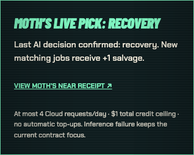

# Live NEAR AI → MOTH → NEAR contract

Activated November 14, 2026, in release `0a8e3c8` at https://rivalghost.xyz. This is a bounded testnet NPC decision loop, with a real Cloud response and a finalized contract receipt.

## What players experience

NEAR AI chooses MOTH’s featured **Recovery** or **Courier** job from public salvage-stock and restored-district counts. The contract grants **one extra salvage** to newly reserved matching jobs. The bonus is frozen when a flight is reserved; an AI update never changes an already-promised reward. Gameplay does not wait for inference.

Workshop → NPC Reactor shows the current contract focus, confirmation state, credit ceiling and a transaction link. The Reactor information tab unlocks after seven chapter clears; the featured-job effect applies to eligible Workshop jobs before that unlock. HOUND remains a deterministic replay pilot with its separately bounded wallet.

## Verified live receipt

The model chose **Recovery** with one salvage in MOTH’s stock. Recovery was already featured: this first decision reaffirmed it. We did not manipulate inventory or focus to manufacture a more dramatic demonstration.

- [MOTH’s finalized `set_focus({"slot":1})` transaction](https://explorer.testnet.near.org/transactions/WR9CuCh9vb3ASBZhy2L1iWW2yvS1pLxEN3Cb27esDXR).
- [Contract upgrade, without reinitializing state](https://explorer.testnet.near.org/transactions/HFgvGMEBNxkeuFL3iXGFqpLb5oF2u9SUcriHgZNzDnuu).
- [Public response, key permissions, finalized action and bytecode evidence](evidence/near-ai-live-focus-2026-11-14.json).
- Deployed bytecode: **99,054 bytes**, **946 bytes below** the strict 100,000-byte ceiling. State stays at version 3; total CR remains **100,100**.



## Authority and spending boundaries

The model returns exactly one JSON enum. It never receives keys, account identifiers, player content or tools. The server constructs `set_focus({slot:1|2})`; it does not execute model-generated transactions.

The new contract method requires MOTH as predecessor, rejects paused operation, deposits, extra fields and invalid choices. It cannot change prices, mint CR, transfer balances, rotate verification keys, change session permissions or pause the game. Existing job reward rules decide the effect of the selected focus.

The server holds a separate **function-call-only MOTH key**, restricted to this contract and `set_focus`, with an initial **0.05 test-NEAR gas allowance**. MOTH’s full-access key stays off the server. The allowance is not a transfer or daily refill. Exhaustion requires explicit operator action.

Cloud retains the existing **$1 total application reservation cap**, **four attempts per UTC day**, **six-hour minimum spacing**, and **$0.003 reserved per attempt**. The original $0.003 pilot reservation was preserved; this activation brought the total to **$0.006**, not a measured provider charge. No automatic top-ups. The actual provider balance/invoice is separate. See [pilot pricing and reservation design](ai-pilot.md).

The chain worker allows at most four MOTH transactions/day with a conservative **0.12 test-NEAR daily gas reservation cap**. The key’s remaining allowance independently limits actual gas spend. These controls are application/key limits; an account owner with another key can still use its authority.

## Recovery behavior

An accepted decision is durably journaled before signing. Signed transaction bytes are persisted before broadcast. A lost response causes reconciliation/rebroadcast of those same bytes, not another Cloud request or fresh transaction. A confirmed cached decision is never applied twice. Known failed transactions remain failed; their reservations are retained.

Unsigned decisions expire after five minutes. Signed transactions are reconciled even after that application deadline, subject to NEAR transaction validity. There is **no on-chain deadline or compare-and-swap guard** in this compact method: a delayed valid transaction can set the bounded focus later. It cannot alter existing job reservations.

Invalid output, unavailable inference, pricing changes, exhausted budgets or paused economy leave the last contract focus intact. A deterministic fallback is never presented as an AI-authored chain update. Pending/error states do not claim confirmation. The AI and HOUND loops run independently; one worker’s exhausted allowance does not stop the other.

## Configuration and rollback

Default fresh clones keep both AI switches off. The live service uses:

```dotenv
NEAR_AI_ENABLED=true
NEAR_AI_ONCHAIN_ENABLED=true
NEAR_AI_API_KEY_FILE=/etc/rivalghost/near-ai.api.key
NEAR_AI_MODEL=Qwen/Qwen3-VL-30B-A3B-Instruct
NEAR_AI_TOTAL_BUDGET_USD=1
NEAR_AI_DAILY_REQUESTS=4
MOTH_FOCUS_ACCOUNT_ID=moth.rivalghost-ops-thekal33d.testnet
MOTH_FOCUS_KEY_FILE=/etc/rivalghost/moth-focus.private.key
MOTH_FOCUS_DAILY_REQUESTS=4
MOTH_FOCUS_DAILY_BUDGET_YOCTO=120000000000000000000000
```

Key files are outside releases and Git, readable only by root and the service group. Startup verifies the focus key’s exact receiver/method and finite allowance. The service uses one persistent SQLite database, preserving all prior budget reservations and player state. A protected database/config backup and previous application release were retained before cutover; previous contract code/state were also saved privately.

To pause future inference and submissions, set **both** AI flags to `false` and restart the service. The current contract focus and all existing rewards remain valid. Reconcile any already-signed pending transaction before removing its key or rolling back code; do not erase the database, budget counters or transaction journal. No schema migration or `new` call is required for this contract upgrade.

## Validation and limits

- 178 TypeScript tests pass with two workers; workspace type checks and production builds pass. The initial fully parallel run timed out in two existing exhaustive gameplay tests; bounded concurrency passed the complete suite without changing tests.
- 20 Rust tests pass. Raw and optimized WASM agree across economy operations, 40 rejected-call cases and bounded-storage cycles. New coverage verifies unauthorized caller, invalid slot, extra fields, attached deposit, paused state, unchanged existing reservations and unchanged retained storage after focus changes.
- Five bridge tests cover durable intent, concurrency, restart recovery, stale/future/invalid/fallback decisions, expiry and known failed transactions.
- Live desktop and mobile Chromium checks found no page exceptions or horizontal overflow and verified the exact confirmed receipt URL. The isolated review profile unlocked the Reactor locally; no live player progression or account was changed. This is browser emulation, not a physical-phone test.
- Independent finalized RPC reads verified the signer, restricted public key, method, zero deposit, return value, total supply and deployed bytecode hash.

NEAR AI hosting is provider-reported. No independent TEE attestation verification, player staking or mainnet execution is claimed. The model chooses a small economic incentive; the server remains a trusted bridge/verifier. This is intentionally constrained automation, not an unrestricted agent controlling the treasury.
